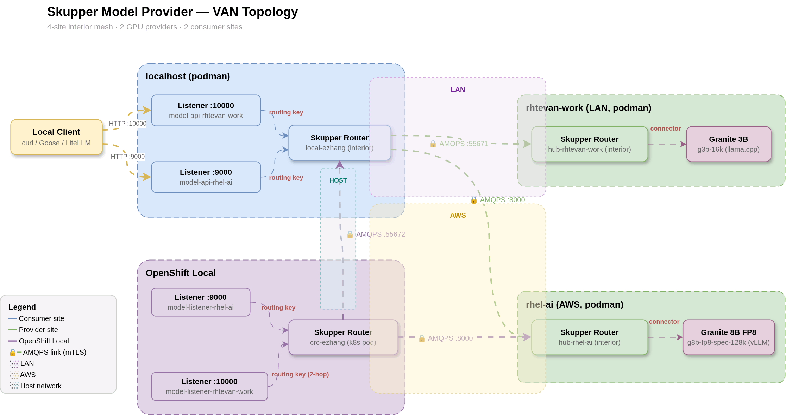

# Architecture

**Interactive diagrams:** [VAN Topology](../docs/van-topology.architecture.html) · [Operational Lifecycle](../docs/operations.lifecycle.html)



```
LOCAL: local-ezhang (localhost, podman)
  ├── link → rhel-ai
  │     host:  RHEL_AI_PUBLIC_HOST
  │     port:  RHEL_AI_INTER_ROUTER_PORT (AMQPS)
  │     Listener :RHEL_AI_MODEL_PORT ← RHEL_AI_ROUTING_KEY
  │
  └── link → rhtevan-work
        host:  RHTEVAN_WORK_PUBLIC_HOST
        port:  RHTEVAN_WORK_INTER_ROUTER_PORT (AMQPS)
        Listener :RHTEVAN_WORK_MODEL_PORT ← RHTEVAN_WORK_ROUTING_KEY

CRC: crc-ezhang (kubernetes, CRC_NAMESPACE)
  ├── link → rhel-ai
  │     host:  RHEL_AI_PUBLIC_HOST
  │     port:  RHEL_AI_INTER_ROUTER_PORT (AMQPS)
  │     Listener :CRC_MODEL_PORT ← CRC_ROUTING_KEY
  │     Service: model-listener-rhel-ai.CRC_NAMESPACE:CRC_MODEL_PORT
  │
  └── link → local-ezhang
        host:  host.crc.testing (192.168.127.254)
        port:  LOCAL_INTER_ROUTER_PORT (AMQPS)
        Listener :CRC_RHTEVAN_MODEL_PORT ← RHTEVAN_WORK_ROUTING_KEY
        Service: model-listener-rhtevan-work.CRC_NAMESPACE:CRC_RHTEVAN_MODEL_PORT
```

All site-specific values (IPs, hostnames, ports, SANs) are read from
`topology.env`. Run `setup.sh --check` to see the full topology
diagram with actual values and validate the configuration.

## Host-Based Routing

Skupper routes by host:port. The active model is determined by
`hosted-model-ctl` (profile-based mutual exclusion), not by Skupper.

| Host | Local Port | Routing Key | Default Profile |
|------|:----------:|-------------|:---------------:|
| rhtevan-work | 10000 | `model-api-rhtevan-work` | `g3b-16k` |
| rhel-ai | 9000 | `model-api-rhel-ai` | `g8b-fp8-spec-128k` |

The `test-model.sh` script and `up.sh`/`down.sh` scoped operations
accept either a host name (`rhel-ai`) or a profile name
(`g8b-fp8-spec-128k`) — profile names are resolved to their host.

## Site Configuration

| Site Name | Platform | Router Mode | Role |
|-----------|----------|:-----------:|------|
| `local-ezhang` | Podman | Interior | Consumer + relay |
| `rhel-ai` | Podman | Interior | Provider |
| `rhtevan-work` | Podman | Interior | Provider |
| `crc-ezhang` | Kubernetes | Interior | Consumer |

## Links

Naming convention: `link-<source-site>-<destination-site>`

| Link Name | From → To | Port |
|-----------|-----------|:----:|
| `link-local-ezhang-rhel-ai` | local-ezhang → rhel-ai | 8000 |
| `link-local-ezhang-rhtevan-work` | local-ezhang → rhtevan-work | 55671 |
| `link-crc-ezhang-rhel-ai` | crc-ezhang → rhel-ai | 8000 |
| `link-crc-ezhang-local-ezhang` | crc-ezhang → local-ezhang | 55672 |

## Configuration Sources

- **Topology config:** `topology.env` (site-specific IPs, hostnames, SANs, CRC config)
- **Shared config:** `scripts/common.sh` (site profiles, helper functions)
- **Podman namespace:** `model-provider-podman`
- **CRC namespace:** `model-provider-crc`
- **CRC operator:** Red Hat `skupper-operator` (`stable-2.2` channel, AllNamespaces mode in `openshift-operators`)
- **System controller:** `--reload-type auto` (cert rotation, config reconciliation)
